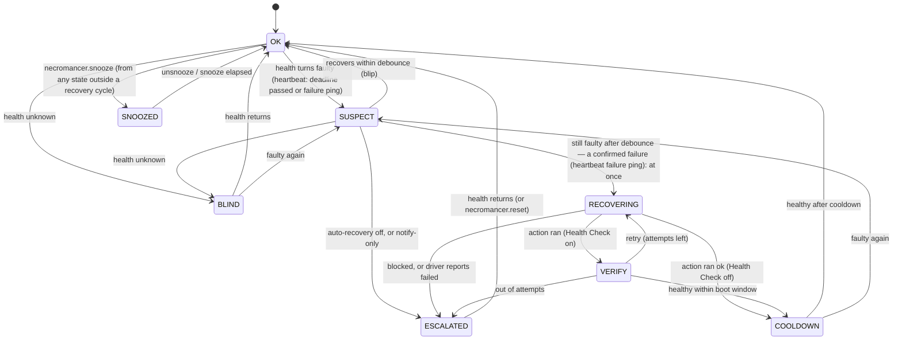

# Necromancer — Architecture

> A generic **self-healing framework** for Home Assistant: it watches devices,
> decides when one is broken, and runs a recovery — power-cycle a switch, run an
> action, or auto-resolve and reboot a PoE port. It replaces the usual pile of
> bespoke "ping → reload/restart" automations with one configurable engine.

---

## 1. Design philosophy

Necromancer is built around **three pluggable layers**, each with a *generic
escape hatch* so the common case needs no custom code and the rare case is still
expressible:

```
 ┌──────────────┐     ┌──────────────────────────┐     ┌──────────────────┐
 │ HealthSource │ ──▶ │ Engine (RecoveryPolicy)  │ ──▶ │ RecoveryDriver   │
 │  "is it ok?" │     │  state machine + timing  │     │  "fix it"        │
 └──────────────┘     └──────────────────────────┘     └──────────────────┘
```

- **HealthSource** answers *“is this device healthy right now?”* → `OK`,
  `UNHEALTHY`, or `UNKNOWN`. `UNKNOWN` is explicitly **not** unhealthy (no false
  alarms).
- **RecoveryPolicy** is the engine’s strategy: `standard` (recover) or `notify`
  (observe only). It gates whether/when recovery is attempted.
- **RecoveryDriver** performs the actual repair.

The guiding rule: **every edge has a generic strategy; bespoke code only where it
pays off** (the PoE port resolver is the single bespoke driver).

---

## 2. Configuration model & lifecycle

Necromancer is a **single service** config entry (`integration_type: service`, added
once, blank). Everything else hangs off it:

| Thing | Where it lives |
|---|---|
| **Service** | One config entry (`data` blank). |
| **Guarded device** | A config **subentry** of type `device` (one per watched device). Added via *“Add device”*, edited via its *Reconfigure* button. |
| **PoE ports** | A flat list in the service entry’s **options** (`entry.options["ports"]`), managed via the **options flow** (add / edit / delete a port, plus **YAML import / export** for bulk edits). |

One `DeviceEngine` is built per `device` subentry and lives in
`entry.runtime_data` keyed by `subentry_id`. Adding/changing a subentry reloads
the service; an options (ports) change also reloads it, so `poe_port` guards always
see a fresh port list.

There is **no per-area grouping** and no second config entry — an earlier
two-entry split was reverted because the HA frontend can’t filter the subentry
picker by type (it would offer both services for every “Add” button).

### How Necromancer maps onto HA — the object graph

```
ConfigEntry  (one, integration_type: service)      entry.entry_id — stable ULID
├─ runtime_data : NecromancerData                  per-entry, dies on unload
│    └─ engines : { subentry_id → DeviceEngine }   one engine per guarded device
├─ subentries  : { subentry_id → device cfg }      the guarded-device config
├─ options     : { ports: [...] }                  PoE port list (options flow)
└─ Store  .storage/necromancer.<entry_id>          durable truth (survives restart)

hass.data[DOMAIN]["fabric"] : PoeFabric            domain singleton, outlives reloads
```

Each `DeviceEngine` owns its view entities (`sensor` / `binary_sensor` / `switch` /
`button` / `event`). Those entities are **pure view** (§9); the engine + Store hold
the truth (§3). `hass.states` is only a volatile in-RAM snapshot, rebuilt from the
Store on every restart — never the source of truth.

### Lifecycle — what HA calls, and when

| HA calls (by name) | When |
|---|---|
| `async_setup_entry` | entry loaded: boot, first add, **after every reload** — registers the heartbeat view (once per HA run), rebuilds the entry's heartbeat token table, builds all engines, then `async_forward_entry_setups` creates the entities. |
| `async_unload_entry` | entry torn down: shutdown, **before every reload**, removal — unloads platforms, **stops the engines, then flushes the Store**. |
| `async_remove_entry` | the integration entry is deleted — drops its Repairs issues and its heartbeat tokens (`404` from then on). |
| `async_remove_config_entry_device` | user deletes a guarded device in the UI. |
| `_async_reload_entry` (registered update listener) | the entry's options/subentries change — calls `async_reload`. |

**One entry → full rebuild.** Every change (a port option, a device subentry, a
health-entity rename) funnels through the update listener →
`hass.config_entries.async_reload` → `async_unload_entry` **then**
`async_setup_entry`. There is no incremental update: *all* engines are torn down and
rebuilt even when a single device changed. Blunt but correct — the whole
engine/link/port graph depends on the config, and at Necromancer's scale (a handful
of guards) the cost is irrelevant. The `entry_id` is stable across reloads and
restarts; only `subentry_id`s tell you *which* guard changed.

**Unload order: stop before flush.** `async_unload_entry` stops every engine first
(which sets the entry's heartbeat tokens to `waiting`, so a new ping gets `503` and is
retried into the next source), then serializes and saves. Flushing first would leave
a window in which a ping lands in a source whose state was already written, and a
late delayed save could overwrite newer data.

**Start error path.** One malformed guard must not take down the entry, so a guard
whose engine fails to build or start is logged and skipped. If `async_start` raises
*after* its source's `async_setup`, it tears its own subscriptions down
(`async_stop`) before re-raising: a heartbeat token would otherwise stay `active` on
a dead source and its pings would get `200` into the void — now it is `waiting`
(`503`).

**Guards without an engine keep their stored state.** `_serialize` snapshots the
running engines and carries the stored blob of **every configured guard without
one** — dormant, or its setup failed — over verbatim. Otherwise the next save
(e.g. another guard's ping) would wipe a failed heartbeat guard's `last_ok`,
`armed_at` and `token_fp`, and it would silently wait for a first success again.
A deleted guard is no longer configured; its blob drops out at the next save.

### Dormant guards — the device-disable switch

Disabling a guard's **own device** in the HA UI is the one gesture that means *this
guard off*, and it is the strongest of the three "off" levels:

| Level | Detects | Recovers | Notifies | Repairs | In link groups |
|---|---|---|---|---|---|
| **Snooze** (`necromancer.snooze`, timed) | no | no | no | yes | yes, inert |
| **Auto-off** (`switch.…_auto_recovery`) | yes | **no** | **yes** (escalates) | yes | yes, escalates |
| **Dormant** (device disabled) | no | no | no | no | **no** |

Auto-off is deliberately loud — it escalates so a real outage still reaches someone
(§6). Dormant is **completely silent**: no engine is built at all, so there is
nothing to detect, recover, notify, escalate or reconcile. One exception keeps the
data honest: a dormant **heartbeat** guard still answers its URL with `200` +
`{"dormant": true}` and writes the ping into its *stored* source state (the same
pure `apply_ping`, no evaluation, no timer, no alarm). Otherwise its `last_ok` would
stay at the last ping before the disable, and re-enabling a guard that was off
longer than its `period` would alarm `heartbeat_overdue` although the job ran
all along. "Completely silent" and "carried over verbatim" therefore hold for the
engine part of the blob only.

HA core makes this our job. Disabling a device cascades **only into the entity
registry** (our five view-entities — six for a heartbeat guard — get
`disabled_by: device`); core neither unloads
the subentry nor signals the integration, and the developer docs define no mechanism
for it. Without the handling below an engine keeps running headlessly — still
power-cycling real hardware, while its `auto` switch and recover button are gone, so
the operator cannot even stop it. We therefore follow core's own precedent
(`netatmo`): read the device registry at setup, and watch it at runtime.

- **Setup** (`_dormant_guards`): a subentry whose device resolves to
  `device.disabled` is skipped before the link closure is computed — no engine, and
  out of every group. A brand-new guard has no device yet (the platforms create it
  from `DeviceInfo`, *after* this runs); an absent device is not a disabled one.
- **Runtime** (`async_track_device_registry_updated_event` on our guard devices): a
  `disabled_by` change in either direction calls `async_schedule_reload`, so
  enabling and disabling take effect at once. **Scheduled, not awaited** — it fires
  from a registry callback, and awaiting a reload there would re-enter the setup that
  registered the listener.
- **The device survives.** `_reconcile_devices` reaps devices with no live guard, and
  the registry lists disabled devices like any other — so dormant ids are passed in
  and spared. Removing one would delete the very device carrying the user's disable,
  and the next reload would recreate a fresh, *enabled* device: the guard would turn
  itself back on.
- **The state survives.** `_serialize` snapshots engines, and a dormant guard has
  none — so its stored blob is carried over verbatim. Otherwise disabling would
  silently reset `recover_count` / `fail_count` and a terminal `ESCALATED` verdict,
  handing the guard a clean slate on re-enable. A dormant heartbeat ping updates
  only the blob's `source` part; before applying it, the endpoint reconciles the
  stored `token_fp` (missing or different: guard created asleep, token regenerated
  in its sleep) with the same reset rule as `restore()` and drops a stored
  `ESCALATED` (`reset_engine_verdict`). A missing blob is created as
  `{"source": {...}}`.

### Runtime updates — entities are push-only

Entities never poll. On any change the engine calls `_emit()`, which invokes each
subscribed entity's `async_write_ha_state`; HA then reads the entity's properties
(`is_on`, `available`, …) and writes a fresh `State` into `hass.states`. One
`_emit()` refreshes a guard's whole entity set at once. (Entity wiring: §9.)

---

## 3. The engine state machine

`core/engine.py` runs a fixed state machine per guard. States
(`sensor.<guard>_status`):



A confirmed failure takes the same exits from `SUSPECT` as an elapsed debounce
(recovery, or `ESCALATED` for notify-only / auto-off), just without the wait — see
*A confirmed verdict skips the debounce* below. `SNOOZED` can be entered from any
state while no recovery cycle runs (`snooze` is refused during one).

**Blind (health unknown while idle).** When health reads `UNKNOWN` — the source is
unavailable or a template render error — while the guard is *idly* monitoring
(`OK`/`SUSPECT`), it shows a distinct `blind` status instead of holding a stale `OK`.
Unknown is **never a fault**, so blind triggers **no** recovery; it returns to
`OK`/`SUSPECT` the moment health reads again. Mid-recovery
(`RECOVERING`/`VERIFY`/`COOLDOWN`/`ESCALATED`/`SNOOZED`) it does *not* go blind — a
device reading unknown mid-reboot is expected, so those states hold.

**Operator services (off the automatic flow).** Three services act on a guard out-of-band:
`reset` clears `ESCALATED → OK` and re-derives from live health (a manual "try again", no
needless repair if already healthy); `snooze`/`unsnooze` move it to/from the `SNOOZED` state —
health is ignored, no transitions, no alerts (planned maintenance). `snooze` takes a
`duration`, **auto-resumes** when it elapses (the remaining time survives a restart), and is
refused (`ServiceValidationError`) while a recovery cycle is in flight; a snoozed guard also
never follows a linked-group repair. Recovering *now* stays the `button.<guard>_revive`,
arming the `switch.<guard>_auto_recovery`. A manual recover press **lifts an active snooze**
(an explicit "fix it now" overrides the suspension) but is **ignored while the guard is
busy or following a linked partner's repair** — interrupting would reset `attempt`
mid-flight or start a competing double-cycle. `reset`/`snooze`/`unsnooze`/`notify_guard` (and
`heartbeat_ping` for heartbeat guards, §9) are **entity** services on the sensor platform
(per guard / device / area); `snooze_all` + `unsnooze_all` are
**domain** services (no target, every guard — "maintenance mode"; busy guards skipped
best-effort) registered in `__init__` alongside `repair_poe_port`.

Key timing fields (the **behaviour** block):

| Field | Meaning |
|---|---|
| `debounce` | How long unhealthy before acting (filters blips); 0 to 86400 s (1 day) for every guard. For a heartbeat it is the grace after a missed ping (default `DEFAULT_HEARTBEAT_DEBOUNCE`, 1 h). |
| `boot_window` | How long to wait for the device to come back (the VERIFY step). |
| `cooldown` | Pause after a recovery cycle before re-arming. |
| `max_attempts` | Retries within one cycle before escalating. |

**A confirmed verdict skips the debounce.** The debounce absorbs blips of a signal
that can flap. A source that was *told* about the fault has nothing to wait out:
the optional hook `HealthSource.confirmed() -> bool` (default `False`) says so, and
today only the heartbeat source returns `True` — while its last ping reported a
failure. The engine then takes the very path an elapsed debounce takes
(`_debounce_done`: notify-only → `ESCALATED` + `problem_detected`, auto off →
`no_auto_recovery`, else the recovery cycle), just without the wait:

- `OK`/`BLIND` → unhealthy and confirmed: `_enter_suspect` → `_arm_debounce` reacts
  at once instead of arming the timer (SUSPECT is entered and left in one tick).
- Already `SUSPECT` (a heartbeat overdue, in its grace) and a failure ping arrives:
  `_evaluate` cancels the debounce timer and reacts now.
- During bootstrap the side effects still wait: `_enter_suspect` defers the start
  of the debounce to `async_at_started`, because the notify/recovery actions may
  not be registered yet; `_debounce_at_started` → `_arm_debounce` then reacts at
  once.

`entity_state`/`template` keep the default, so a second unhealthy update while
`SUSPECT` changes nothing for them.

**A known fault start shortens the debounce to its rest.** The debounce timer
lives only in memory: an entry reload or an HA restart rebuilds the engine, and
re-arming the full debounce then would push the reaction back each time (a guard
reloaded every 50 min of a 1 h debounce would never react). A source that knows
**when** its fault began, from its own stored state, says so through the optional
hook `HealthSource.fault_since() -> datetime | None` (default `None`); today only
the heartbeat source answers, with its passed deadline (`basis + period`) while
overdue, and `None` after a failure ping (that is `confirmed()` anyway) and while
OK or waiting. Every arming of the debounce goes through `_arm_debounce`
(entering `SUSPECT` from `OK`/`BLIND`/`COOLDOWN`, the deferred start at HA started,
the fallback after a linked repair), which then waits only
`_debounce_remaining()` = `debounce − (now − anchor)`, clamped to
`[0, debounce]` (an anchor in the future counts as nothing elapsed). The anchor
(`_debounce_anchor()`) is `fault_since`, but never before the engine's own last
reaction: the start of its latest recovery cycle (`last_cycle_start`) or the end
of the cooldown after its latest repair (`last_recover + cooldown`). A fault that
outlives a repair is a new round and earns a full debounce again, as for any
other source. Without that, a grace once used up would stay used up: every
cooldown end (an action without health check, sender still silent), every reload
during `COOLDOWN`/`RECOVERING` (not persisted, so the guard comes back as `OK`)
and every HA restart made by the recovery action itself would start the next
cycle at once — a repair loop paced only by the cooldown, or a boot loop paced
only by the boot time. `last_cycle_start` is persisted for exactly this, since
the `RECOVERING`/`VERIFY` it starts are not. A rest of 0 takes the same path as an
elapsed debounce at once: after a long HA outage the grace may be used up, and
the reaction follows right after the start (a deadline is a deadline; a sender
retry a second later turns the guard OK, but the alarm is out). A source returning
`None` keeps the full debounce from the moment the engine sees the fault, exactly
as before (the reaction marks are ignored then).

**Health Check vs the driver's own verdict.** `recover()` returns a bool verdict
(`True` = ran cleanly, `False` = ran but reported failure); `behavior.health_check`
(a per-recovery toggle in the wizard, default on) decides who gets the final say:

- **On**: after `recover()`, the engine waits (event-driven, up to `boot_window`)
  for the HealthSource to read `OK`. Not OK within the window → retry up to
  `max_attempts` → `ESCALATED`. The driver's own verdict is only *recorded*
  (`last_recover_driver_result`), not the decider.
- **Off**: the **driver's verdict decides** the attempt — `True` → success; `False`
  (the action set `recover_failed`, or a PoE port that didn't come back online) is a
  **failed attempt** (retry up to `max_attempts` → `ESCALATED`), *not* a blind
  assumed success. The continuous health monitoring still re-triggers later if a
  clean-looking recovery didn't actually hold. *(If `recover()` raises — e.g. a
  missing service — it likewise counts as a failed attempt, never a success.)*

**Reload the assigned device's integration (optional).** If a device is assigned
and the guard has `behavior.reload_entry`, then after `recover()` (and before
VERIFY) the engine waits `reload_delay` seconds and reloads the device's config
entry — `device.primary_config_entry` (fallback: all `config_entries`) via
`hass.config_entries.async_reload` (`_maybe_reload_device_entry`). Best-effort: a
missing device or a failing reload is logged but never aborts the cycle — VERIFY
still decides success. Lets HA reconnect to a device that just came back without
scripting a `homeassistant.reload_config_entry` action.

**Persistence.** Runtime state is persisted in a `Store`
(`.storage/necromancer.<entry_id>`), independent of the display entities. Per
guard the engine stores `{state, attempt, recover_count, fail_count, last_recover,
last_seen, last_fail, last_recover_driver_result, last_recover_driver_time,
last_cycle_start, auto, snooze_until, source}`, where `source` is the health source's own `snapshot()`
(`{}` for sources without state; a heartbeat's pings — additive, `STORAGE_VERSION`
unchanged). Alongside those per-guard snapshots the same Store file holds the PoE
fabric's `id → port` cache under a separate `_poe_cache` key (written by
`__init__`'s `_serialize`). On restart `source` goes to `health.restore()` first,
then the stats and `auto` flag are restored, `ESCALATED` is restored (then
re-derived from live health), `SNOOZED` is restored (re-arming the *remaining*
snooze, or resuming if it elapsed), and transient states
(RECOVERING/COOLDOWN/VERIFY) are *not* restored — they come back as
OK/live-health. If `restore()` reports a new source identity (a regenerated
heartbeat token, a type switch to heartbeat), the stored `ESCALATED` judged
something that no longer exists and is dropped (`state` ok, `attempt` 0, via
`reset_engine_verdict`); a `SNOOZED` stays. The engine also hands its save callback
to the source (`bind_persist`), since a source can change state the engine never
sees as a transition (an OK→OK ping). The fabric's `_poe_cache` is restored too, so a `poe_port` guard
keeps its last-known fallback port across a reboot. The display entities
(`sensor.*_status`, `binary_sensor.*_health`, `switch.*_auto_recovery`,
`button.*_revive`, `event.*_recovery` and a heartbeat guard's `sensor.*_last_heartbeat`)
are **pure view**; the `Store` is the source of truth.

**The reason behind an alarm.** On every state change the engine reads
`health.detail()` synchronously and keeps the rendered text (`health_detail`), so
the alarm and the guard's status carry the reason *as it was at the finding* — it
does not drift as time passes. The text goes with every alarm notification as a
second sentence: `problem_detected` and `no_auto_recovery` (`_debounce_done`), the
**first** `recovery_attempt` of a cycle (read before its `await`; later attempts
would only repeat it), `recovery_failed` (`_escalate`) and, generically,
`linked_repair_failed` and the auto-off `no_auto_recovery` of a follower
(`core/links.py`). Not on `recovery_success`, nor on `recovery_blocked`, which has
its own reason. Sources without `detail()` send `""`, so their texts are unchanged.

---

## 4. Health Sources (`core/health/`)

`evaluate() -> Health` is always callable (so the VERIFY step can re-check). A
source that tracks something other than entity states registers its own listener
in `async_setup(on_change)` (returns an unsub) and exposes an empty
`watched_entities`.

| Type | What it is | Healthy when |
|---|---|---|
| `entity_state` | One entity’s state or attribute vs on/off **value lists**. | value ∈ `on_value` → OK; ∈ `off_value` → unhealthy; else `UNKNOWN`. `unavailable`/`unknown` → `UNKNOWN` **unless** listed in `off_value` (explicit off wins). |
| `template` | An inline Jinja template that returns a boolean. | whitelist: `true`/`on`/`1`/`yes` → OK, `false`/`off`/`0`/`no` → UNHEALTHY; anything else (render error, blank, `none`, `unknown`/`unavailable`, unrecognized text) → `UNKNOWN`. |
| `heartbeat` | A job outside HA POSTs to a secret per-guard URL; config `token`, `period` (seconds), `local_only`. The grace after a missed ping is the guard's `debounce` (§3). | first matching row wins: last ping a failure → UNHEALTHY (`confirmed()`); no success yet and the deadline ahead → `UNKNOWN` (waiting); no success yet and the deadline past → UNHEALTHY; `now > basis + period` (basis = last success, else `armed_at`) → UNHEALTHY; else OK. No startup grace. |

The **template** source is the inline alternative to building a template *entity*.
Because a template is a continuous, checkable expression (unlike a momentary
*trigger*), it supports the full recover→verify cycle. It is tracked via
`async_track_template_result`, so health re-evaluates whenever a referenced
entity changes.

The **heartbeat** source (`core/health/heartbeat.py`) has no entity at all: each
guard owns a token, and a sender POSTs `/api/necromancer/heartbeat/<name>_<token>`
with an optional `status` (missing/`ok`/`0` = success, anything else = failure; a
short, harmless failure value is kept as `last_code` for the message). Only the
token after the last `_` counts, the name is for readable logs. The logic is a set
of pure functions (`parse_status`, `apply_ping`, `evaluate`, `next_deadline`,
`reconcile_token`); `HeartbeatHealth` wires them up. Its `async_setup` marks the
token **active** in the domain-wide token table (`core/heartbeat_registry.py`,
`hass.data[DOMAIN]["heartbeat"]`: token → `active`/`waiting`/`dormant`, `local_only`,
source, a 5-pings-per-10-s rate limiter) and arms a point-in-time timer on the next
deadline that calls `on_change`. Its unsub sets the token back to **waiting**,
cancels the timer and closes the source: a ping that races a reload is refused
(`HeartbeatClosedError`) instead of touching the stopped source, so the sender
retries and the next source gets it. The full token never appears in logs,
attributes or `describe()` (just `heartbeat`).

**Grace = debounce.** The source has no grace of its own (no separate
"period + grace" pair): it turns UNHEALTHY at `basis + period`, the engine enters
`SUSPECT` and waits its normal `debounce`, and a late success in that window ends
it with no notification; after the debounce the normal reaction follows. The
debounce counts from the deadline (`fault_since()`, §3), not from the moment the
engine noticed, so the reaction comes at `deadline + debounce` however often the
entry reloads or HA restarts in between. A
reported failure is different — the sender said the job failed — so
`confirmed()` is `True` while the last ping is a failure, and the engine reacts at
once (§3), also cutting a running debounce short. A guard that never succeeded is
`UNKNOWN` (`blind`) until `armed_at + period`, then the same `SUSPECT` → debounce →
`heartbeat_never`. After an HA restart an overdue guard re-enters `SUSPECT` for
the rest of its debounce (a sender's retry within it still clears it silently;
an outage longer than deadline + debounce reacts right after the start); a persisted
`ESCALATED` stays without a new alarm. A `grace` key left in a stored health config
(dev data) is never read.

**The endpoint** (`heartbeat_view.py`, `HeartbeatView`) is a plain
`HomeAssistantView` (`requires_auth = False`, like `camera`/`auth` in core; **POST
only** — there is no `get` handler, so aiohttp answers GET and every other method
with `405` and a link preview, prefetch or cache never counts as a heartbeat;
`max_body_size = 1024`), not HA's webhook component: a webhook answers `200`
for everything it drops (unknown id, non-local caller, handler exception) to hide
whether a hook exists, so a sender could not tell "processed" from "lost". HA can
add a view at runtime but never remove one, so it is registered **once per HA run**
(flag in `hass.data[DOMAIN]`), and everything that changes lives in the token table.
`async_setup_entry` rebuilds the entry's part of it from the **subentry data** (not
from the engines) *before* any engine starts — every token is first `waiting` or
`dormant`, only the source's `async_setup` makes it `active`; tokens no longer
configured drop out. `async_unload_entry` sets the entry's tokens `waiting`;
`async_remove_entry` removes them. A request runs through a fixed, tested order:

1. token from the path (after the last `_`) → table; unknown → `404`;
2. `local_only`: not local → `403` — checked only after the lookup, so a `403` tells
   nothing to a caller without the token. Local means what HA's webhook means:
   not a cloud connection and `is_local(ip_address(request.remote))` (loopback,
   link-local, RFC1918, ULA); an unparsable IP is not local;
3. rate limit, 5 pings per 10 s per guard → `429` (a rejected ping is not counted);
4. `parse_status(status)` → by token state: `active` → `async_handle_ping` →
   `200 {"health": …}` (`HeartbeatClosedError` → `503`); `dormant` → stored only,
   `200 {"dormant": true}`; `waiting` → `503`.

Any unexpected exception → `500`, logged with only the first 6 token characters
(`web.HTTPException` passes through). The body is never read. Everything the sender
should retry is `404`, `429` or `5xx`; `400` (HA's security filter, a stray
`X-Forwarded-For`) and `403` are final.

Two optional hooks on `HealthSource` (no-op defaults, other sources are unaffected)
serve sources with state of their own:

- **Persistence** — `snapshot() -> dict` / `restore(dict) -> bool` carry the source
  state through the Store; `bind_persist(save)` hands the source the engine's save
  callback, because an OK→OK ping changes no engine state and would otherwise never
  be saved. The heartbeat snapshot holds `last_ping`, `last_ok`, `last_status`,
  `last_code`, `armed_at` and `token_fp` (first 12 hex of the token’s SHA-256,
  never the token). `restore()` returns True when the fingerprint is missing or
  differs (new token, type switch): the state restarts armed now, and the engine
  drops a persisted ESCALATED.
- **Reason** — `detail() -> (key, params) | None` names why the verdict is what it
  is (`heartbeat_failed`/`never`/`overdue`/`waiting`), as a key into
  `DETAIL_MESSAGES` (`const.py`, de/en, separate from `NOTIFY_MESSAGES`). `None` =
  no detail.

The wizard’s first step picks the source type (`state_based` / `template_based` /
`heartbeat_based`); see §8 for the heartbeat fields, the token and the URL step.

---

## 5. Recovery drivers (`core/drivers/`)

`recover()` performs the repair and returns a **bool verdict** (`True` = ran cleanly,
`False` = ran but reported failure; raising = hard failure) — used to decide the
attempt when the Health Check is off, and recorded for diagnostics when it's on (§3).
`can_recover()` is a pre-flight guard that blocks (→ `recovery_blocked`, no blind
action) when something is missing.

| Driver | Action | Verdict (`recover()`) | Pre-flight (`can_recover`) |
|---|---|---|---|
| `switch_cycle` | `turn_off` → `off_on_delay` → `turn_on`. | `True` unless it raises. | switch entity exists. |
| `action_call` | Run one user-defined action sequence (script syntax). | `False` if the action set `recover_failed`, else `True`. | action valid & non-empty. |
| `action_cycle` | Run an *off* action → delay → *on* action. | `False` if the on action set `recover_failed`, else `True`. | both actions valid. |
| `poe_port` | Resolve the device to a PoE port by `expected_id`, then cycle its actuator with staged status verify. Learns the port while healthy and falls back to the last-known port when the device has aged out. | the fabric's "did the port come back online?" result. | one live **or** last-known port. |
| `noop` | Nothing (used by notify-only guards). | `True` (never reached). | — |

User actions are validated (`cv.SCRIPT_SCHEMA` + `async_validate_actions_config`)
and run via the `Script` helper (`core/actions.py`), blocking for recovery, detached
for notifications.

**Action variable scope.** `recover(variables)` is handed the engine's run context —
`attempt`, `max`, `name`, `guard_entity_id` (the guard's status sensor, e.g. the
`necromancer.notify_guard` target) — which the action-running drivers (`action_call`,
`action_cycle`) seed into the script run as template variables (`switch_cycle` / `poe_port` /
`noop` ignore it). `async_run` returns the run's **final variable scope** (minus HA's injected
`context`); the action signals a failed attempt by setting `recover_failed` true in that scope
(the driver's verdict, §3), and `action_cycle` feeds the off action's scope into the on action — so off-phase
`variables:` and the engine context are both readable in the on phase, with no helper entity to
carry state across the power-cycle. Variables are per-attempt (each retry runs off→on fresh);
nothing leaks between attempts. Within a run the scope is one flat namespace (HA
`ScriptRunVariables`, a ChainMap whose writes land in the nearest scope that already defines the
name, else top-level): a `variables:` set inside an `if`/`choose`/`repeat`/`sequence` leaks to the
rest of the run — and on into the on phase — so a *conditionally* set variable is simply `undefined`
when its branch is skipped (read it with `| default(...)`). Only `parallel` branches are isolated
(each gets a copy, merged back afterwards); `repeat`'s `repeat` var and a parallel-`protected` `wait`
are the sole truly-local names.

### The strategy matrix

The wizard offers **5 options**: notify-only plus 4 recovery strategies (one per
action shape). The Health Check is a separate per-recovery toggle
(`behavior.health_check`, default on), not a strategy variant:

```
notify    → noop
switch    → switch_cycle
action    → action_call
actions   → action_cycle
poe_port  → poe_port      (own staged verify; + device Health Check when enabled)
```

A strategy maps to a `driver type`; `behavior.health_check` (the toggle) decides
whether the engine's VERIFY step runs. Auto-PoE keeps its own staged verify (port
goes offline → comes online) on top of the device Health Check (when enabled); with
the Health Check **off**, that staged "did the port come back?" result is the
driver's verdict and decides the attempt (a port that didn't return = a failed
attempt), instead of being discarded.

**Auto-PoE remembers its port.** A device that is down can age out of the
switch's FDB/LLDP neighbour table, so resolving it live would find *nothing*
exactly when recovery is needed. The **fabric** keeps a last-known `id → port`
cache and learns continuously: it watches every configured port's id-entity
(`_rewatch` → `_on_change` → `_relearn`/`_learn`), so it caches the mapping the
moment the neighbour table reports the device — not only on a health event. At
recovery time a single live match still wins (and refreshes the cache); on
**zero** live matches `resolve_with_reason` falls back to that last-known port —
but only if that port currently reports *nothing* connected; if it now serves a
*different* live id (the device was re-cabled away) the stale entry is dropped and
it blocks ("no port matches") rather than cycling the wrong device (logged at
WARNING); an **ambiguous** (>1) match still blocks. The cache lives in
the fabric (not per guard) and is persisted in the Store under `_poe_cache`; the
`poe_port` driver is a thin adapter that just delegates resolve + cycle to it.

### PoE fabric & the `repair_poe_port` service

The `poe_port` driver cycles a port from *inside* a guard. Some recoveries instead
need to cycle a port from an **action** — e.g. cut PoE, wait for ping, then *reload*
a config entry (the lamps only return after the reload), a sequence a driver can't
express. The **PoE fabric** (`core/poe.py`) is that shared, port-level primitive: a
domain-singleton holding the live + last-known `id → port` map (same resolution as
`poe_port`, watching every port's id-entity), a per-port **status**
(`good` / `recovering` / `failed`) and a per-port **in-flight cycle**. A cycle that
*raises* (e.g. the actuator service is gone) leaves the port on `failed`, never
stranded on `recovering`. It backs the
**`necromancer.repair_poe_port(id)`** service — blocking, and **coalesced** per port:
concurrent callers (multiple guards, automations) join the one in-flight cycle and
share its result instead of each cycling the port. Each status change is fired as a
`necromancer_poe_port` event. The
fabric is wired in `__init__` (singleton in `hass.data`, port list + cache from the
Store). The staged cycle lives **only** in the fabric — the `poe_port` driver delegates
resolve + cycle to it (`can_recover` → `resolve_with_reason`, `recover` → `repair`), so a
guard and the service share one cache and coalesce onto one in-flight cycle per port.

---

## 6. Guard linking (groups)

Guards that share a root cause are grouped so only **one** recovers and the rest
follow — e.g. a *ping* guard and a *lamps-unavailable* guard on the same Hue bridge.

- **Declaration & closure.** Every recover guard has a collapsed *Linked guards*
  multi-select (`linked_guards` = partner subentry_ids). The relation is
  **undirected + clique-closed**: `core/links.py` (`link_components`) builds connected
  components over the union of all declarations, so a one-sided link still reads and
  behaves as a full mutual group. The config flow reads the closure for the form
  default; `__init__` reads it to give each engine its effective partners. Only
  **recover** guards take part — both the flow's options *and* the setup closure
  exclude notify-only guards, so a guard reconfigured to notify-only drops out of
  every group (no inert ghost member). Unlinking clears the edge on **both** sides
  (`_apply_link_removals`), so the only way out of a group is to clear *all* its
  partners (a single shared partner re-forms the clique).
- **Coordination.** When a guard starts recovery the engine calls `self.links.notify_start()`
  (`LinkCoordinator` in `core/links.py`), which calls each partner's coordinator
  (`peer.links.on_partner_repair_start`) **and** fires a `necromancer_guard_repair` bus event
  for outside automations). A partner that isn't already busy enters a **follow hold**
  (RECOVERING, no own action) and suppresses its own health-driven transitions. When
  the leader finishes (`self.links.notify_done(success)` → each partner's
  `on_partner_repair_done`), each follower re-validates (`validate_after_repair`):
  - healthy → it settles through the **same `_recover_success` path** (cooldown +
    stats) as the leader, instead of snapping back to OK — but called with
    `via_link=True`, so its `recovery_success` **notification is suppressed by
    default** (one root-cause repair → one success push, the leader's). Opt in per
    guard with `behavior.notify_follower_success` (a toggle in the *Linked guards*
    section). The `necromancer_guard_repair` event still fires per guard regardless;
  - still unhealthy **and the leader succeeded** → only the follower's device is
    still down, so it falls back to its own recovery. It releases the cycle slot
    (`_cycle_task`) *before* re-deriving via `_evaluate`: a confirmed verdict
    (heartbeat failure ping) skips the debounce and starts the cycle right there,
    which the busy-guard would otherwise drop (stuck in SUSPECT, no timer). The
    `finally` clears the slot only while it still holds the validate task;
  - still unhealthy **and the leader failed** → the shared cause is unfixed, so the
    follower **escalates** (`linked_repair_failed`) rather than self-recovering and
    re-triggering the group (no cascade).
- **Arbitration is first-come.** A guard claims the leader role *synchronously* in
  `_start_cycle` (sets `RECOVERING` before the cycle task runs), so a linked partner
  whose debounce elapses in the same tick already sees it as repairing
  (`links.find_repairing_partner`) and follows —
  no double-cycle even on simultaneous trips.
- **Auto-off means off.** A guard whose `auto` switch is disabled never participates
  in a group repair: instead of following, if its own device is affected it
  **escalates** (`no_auto_recovery`). It is never silently fixed by a partner.
- **A dormant guard is not in the group at all.** Its device being disabled takes it
  out of the link closure, so it neither leads, follows nor re-verifies (§2).
- **Heartbeat guards never link.** `_is_recover` (setup closure) excludes
  `health.type == "heartbeat"`, like notify-only guards, so a stale `linked_guards`
  is ignored at runtime. A heartbeat leader with a job restart would hold every auto
  partner for up to `max_attempts × boot_window` (by default 2 × up to 1 h, at most
  10 × 1 h), during which a
  real partner outage goes unnoticed — and a job restart rarely fixes a cause shared
  with a device. The flow agrees (§8): `_recover_guards` leaves heartbeat guards out
  of the pick list, the default and the unlink diff, `_with_link` adds no link
  section to a heartbeat guard, `_build_data` stores no `linked_guards` for it, and a
  linked guard switched to heartbeat is removed from every partner
  (`_apply_link_removals`).

---

## 7. Notifications as actions

There are no fixed notify targets. Each guard optionally defines a **notify
action** (an `ActionSelector` sequence) that runs on events
(problem / recovery / escalation). Necromancer resolves a localized message and
exposes it to the action as Jinja variables:

| Variable | Value |
|---|---|
| `message` | The full ready-made line, `"<name>: <event_text>"`. |
| `name` | The guard name. |
| `event_text` | The localized event text **without** the name (so the user can compose their own line / avoid duplicating the name in a title). |
| `event` | The notify key (`recovery_success`, …). |
| `attempt` / `max` / `attempts` / `reason` | Event params, where applicable. `attempts` is the plural-correct phrase ("1 Versuch" / "3 Versuche"). |
| `health_detail` | Why the source judged as it did, as plain text (e.g. "Kein Lebenszeichen seit 26 Stunden, erwartet alle 24 Stunden."), `""` when the source gives no detail or the event carries none (see §3, *The reason behind an alarm*). |

The texts (`NOTIFY_MESSAGES` in `const.py`) are the **name-less** `event_text`;
`core/notify.py` (`_resolve`) prepends `"<name>: "` for `message` and computes `attempts`.
They're phrased for **TTS** — numbers as words ("1 von 2", not "1/2"), no
slashes/parentheses. So `message: "{{ message }}"` just works; the user decides
whether/how to notify. The action runs **detached** so a user delay never stalls
the engine. Every variable is always set (unset ones are `""`), so a template needs
no `| default`.

**Detail sentence.** A non-empty `health_detail` is appended to `message` and
`event_text` as a second sentence ("pve-sicherung: Problem erkannt. Kein Lebenszeichen seit
26 Stunden, erwartet alle 24 Stunden."); `event` stays the same key, so
automations branching on it see no difference. The texts live in their own table,
`DETAIL_MESSAGES` (`const.py`, de/en), because they are not events but a reason
for one. Their placeholders are rendered by `core/notify.py` (`render_detail`) and
are **not** action variables: `{since}` and `{period}` are seconds turned into a
spoken duration by `_format_duration(lang, seconds, *, dative=False)` — minutes
under 2 h, hours under 2 days, else days, singular/plural, and in German the case
of the preposition (`{since}` after "seit"/"vor" takes the dative, "seit 3 Tagen";
`{period}` after "alle" the accusative, "alle 7 Tage"); `{code}` becomes a clause
from `DETAIL_CODE_PHRASES` (", Exit-Code 3" for digits, ", Code TERM" for a word,
nothing without a code).

---

## 8. Config flow (`config_flow.py` + `config_flow_helpers/`)

The handler classes stay in `config_flow.py` (which must remain a file — hassfest
requires it); the schema/selector builders live in the `config_flow_helpers`
package (`schemas.py` + reactive `selectors.py`).

Steps: **source type → device & state → strategy → recovery/notification**, and
for a heartbeat guard one more **URL info step** before saving. The
strategy step lists **notify-only** (first) plus the four recovery strategies;
picking notify-only routes to a notification step instead of a recovery one. There
is no separate "mode" field — the notify-vs-recover choice *is* the strategy choice.

- **Three source types.** `_source_schema` offers `state_based`, `template_based`
  and `heartbeat_based`; `_source_type_of` maps a stored `health.type` back
  (`template` / `heartbeat` / anything else = state).
- **Heartbeat device step.** `name`, `period` (default `DEFAULT_PERIOD`, 1 day),
  `local_only` (default on) and the optional `device_id`. There is **no grace
  field**: the grace after a missed ping is the debounce of the last step (see
  per-type defaults). `period` is a `DurationSelector(enable_day=True)` field: the
  selector hands back a dict, the flow stores **seconds** like every other time
  field (`_as_seconds`) and pre-fills a dict again (`_as_duration`). Because its
  value is a dict, `_flatten_sections` must not lift it (`_DICT_VALUED_FIELDS`).
  After the conversion `period < 60` s is rejected (`period_too_short`). A `grace`
  in a stored health config (dev data) is not pre-filled and is dropped on the
  next save.
- **Token.** `async_step_device` settles it in `step1` so the pure `_build_data`
  only copies it: `secrets.token_hex(32)` for a new guard and for a type switch to
  heartbeat, the stored one on every other reconfigure — unless the reconfigure-only
  toggle `regenerate_token` (shown only for a guard that already is a heartbeat
  guard, never stored) asks for a new one. The new token’s fingerprint differs from
  the stored `token_fp`, so after the reload the source restarts armed now and the
  engine drops a stored ESCALATED (§4): the guard waits again (`blind`,
  `awaiting_first_success`).
- **URL info step.** `_finish` parks the built data and shows `heartbeat_url`
  (empty schema, like `export_result`) **before** `async_create_entry` on create and
  before `async_update_and_abort` on **every** reconfigure that ends as a heartbeat
  guard — those two calls take no placeholders, and closing the dialog here saves
  nothing, so a new token never exists unseen. After `regenerate_token` the same
  handler shows the step as `heartbeat_url_new` (same placeholders, text says the
  old URL stops working); the frontend submits to the shown step id, so both ids
  route to one method. The URL comes from `ping_url` in `core/health/heartbeat.py`
  (shared with the `heartbeat_url` service, §9): `get_url(hass, allow_external=not
  local_only, prefer_external=False, allow_ip=True)` + `ping_path(name, token)`
  (`/api/necromancer/heartbeat/<slugify(name)>_<token>`). `prefer_external=False` is
  explicit because with SSL `get_url` would otherwise prefer the external URL,
  which contradicts `local_only`. On `NoURLAvailableError` only the path is shown;
  the step text says to put the HA address in front. The URL and three example calls
  — `example_ok` (`curl -fsS -X POST "<url>"`), `example_fail` (`…?status=fail`) and
  `example` (`…?status=$?`); the endpoint takes POST only — are **only placeholders**:
  a literal brace in the translation would break the ICU rendering.
- **Switching away from heartbeat** needs no extra step: the reconfigure source
  step’s field description says the URL becomes invalid (senders get `404`).
- **Per-type defaults.** The strategy default is `notify` for a new heartbeat guard
  and for a type switch to heartbeat (otherwise the stored strategy, or `switch`
  on create). The debounce default is `DEFAULT_HEARTBEAT_DEBOUNCE` (3600 s) for
  heartbeat — it *is* the grace after a missed ping; a reported failure skips it
  (§3) — and `DEFAULT_DEBOUNCE` otherwise. The debounce box (`_debounce_field`)
  goes up to `MAX_DEBOUNCE` = 86400 s (1 day) for **every** guard, and its field
  description (all forms) explains the heartbeat meaning. In a reconfigure the
  stored debounce reaches the form through `_behavior_defaults(data, source_type)`
  (called by every strategy’s `*_defaults`), which replaces it when the edit
  crosses the heartbeat boundary — 3600 towards heartbeat, `DEFAULT_DEBOUNCE` away
  from it; the schemas’ own `source_type` default only matters on create.

- **Flat device step.** The device & health step is **section-less**: its fields
  (`name`, `entity_id`, `attribute`, `on_value`, `off_value` for state-based — or
  `template` for template-based — plus the optional `device_id`) are all
  **top-level** (`_health_fields` returns a flat dict). So the flow submits a flat
  dict — e.g. `{"name": …, "entity_id": …, "on_value": [...], "off_value": [...]}`
  for state-based, `{"name": …, "template": "…"}` for template-based, with
  `device_id` top-level — not nested `state_check`/`template_check`/`assigned_device`
  sub-dicts.
- **Sections (recover steps).** The recovery/notify forms still group fields into
  `data_entry_flow.section`s with a heading and description (recovery action,
  behaviour, notification, linked guards, and — only when a device is assigned —
  *reload* the assigned device's integration after a repair; ports: switch /
  recognition / status / timing). Sections nest their values, so submitted input is
  flattened back up (`_flatten_sections`); on the now-flat device step the same
  helper is a harmless no-op.
- **Reactive selectors.** Attribute and state pickers follow their sibling entity
  field live via a per-field `context` mapping (`filter_entity` / `filter_attribute`).
  The reacting field and the entity it follows must sit in the **same form scope**:
  on the flat device step they share the top-level form; inside a port (which keeps
  its sections) they stay in the same section, since each section renders its own
  nested `ha-form` that regenerates context from the section’s data.
- **Own entities excluded — scoped.** The switch/actuator/port pickers exclude
  **all** Necromancer entities (`_own_entities`) — you never power-cycle a view
  entity. The **health** picker excludes only **this guard's** entities
  (`_own_guard_entities`, by `subentry_id` prefix), so a self-loop can't be picked
  but **other** guards' `*_status` / `*_health` stay selectable — that's what
  enables **supervisor / staged guards** (a template-health guard watching other
  guards). A genuine self-reference is still caught by the feedback-loop check.
- **Config validation timing.** `engine._check_config` (missing/disabled health,
  driver errors, blind-template, self-reference loop) is scheduled **by `__init__`
  after `async_forward_entry_setups`**, wrapped in `async_at_started`. So it runs
  once HA is started *and* the guards' own view-entities are registered — the
  self-reference check sees them even for a guard added at runtime (not just after
  the next restart).
- **Repairs (Settings → Repairs).** The same user-fixable config problems are also
  surfaced as **Repair issues** so they're visible, not just in the log:
  `engine.config_problems()` reports a guard whose health entity is missing/disabled
  (blind), a health template that reads only missing/disabled entities, or an invalid
  recovery action; `fabric.port_problems()` reports a port with no id source or a
  missing actuator/status entity. `_reconcile_issues` (in `__init__`) creates/deletes
  issues to match — idempotent, so it self-clears: fixing the config saves and reloads
  the entry, dropping the stale issue. It re-runs at startup, on reload, and
  **event-driven** when a watched entity appears/disappears (`_on_watched_change`), and
  `async_remove_entry` drops our issues on integration removal.
- **Auto-recovery is not a setup field.** It is the per-guard runtime switch
  entity (Store-persisted); guards start with it on.
- **Options flow (ports).** A button menu (`async_show_menu`) over the flat port
  list: add / edit / delete a port (edit reuses the `add_port` step), plus
  **import / export** for bulk edits. *Export* multi-selects ports (all
  pre-selected) and dumps them to YAML; *import* parses pasted YAML and either
  **merges** (upsert by `label`) or **replaces** the list — every port is
  validated (`_parse_ports_yaml` → `_normalize_imported_port`: required
  label/actuator/status_entity, timings numeric and ≥ 0) and nothing is applied
  on error (the reason is surfaced via `description_placeholders`). YAML
  round-trips cleanly: `_ports_to_yaml` quotes on/off values and import coerces
  YAML 1.1 booleans (`on`/`off`/`yes`) back to strings, so the bool footgun can’t
  corrupt a status list.
- **Translations.** Custom components ship **no `strings.json`** (it is a Core
  build-time source); `translations/en.json` is the source HA loads directly, and
  `translations/de.json` mirrors it. HA renders config translations via **ICU
  MessageFormat**, so descriptions must contain **no `{…}` braces** except real
  `description_placeholders`.

---

## 9. Entities & platforms

Per recover guard, five pure-view entities on **one device per guard**:
`sensor.*_status`, `binary_sensor.*_health`, `switch.*_auto_recovery`
(`entity_category: config`), `button.*_revive`, and `event.*_recovery` (event types
`recovered` / `escalated` / `blocked`, fired from `_recover_success` / `_escalate` via
the engine's `add_event_listener` hook). Notify-only guards omit the switch, button and
event. A **heartbeat guard** adds one more: `sensor.*_last_heartbeat` ("Last heartbeat" /
"Letztes Lebenszeichen", `device_class: timestamp`, unique_id `<subentry>_last_heartbeat`).
Its value is the source's `last_ping` (any ping, success or failure). Attributes:
`next_due` = basis + `period`, the current deadline (`None` after a failure ping,
which is unhealthy at once); `period` (seconds); `grace` (seconds) = the guard's
debounce, i.e. how long `SUSPECT` waits after `next_due` before the reaction. The
last two only change with a reconfigure (reload). It refreshes on every ping through the engine's listener (`on_change` →
`_evaluate` always ends in `_emit`), so it writes one recorder row per ping — that is its
purpose; whoever doesn't want the history excludes it from the recorder.
`_reconcile_entities` removes it (like the control entities of a guard that turned
notify-only) once the guard no longer uses the heartbeat source, so a type change leaves
no orphan registry entry.

The guard's device is keyed by its subentry (`identifiers={(DOMAIN, subentry_id)}`) and
named after the guard, whether or not a device is assigned. An assigned device that
resolves is passed as `via_device_id`, which nests the guard under it without claiming
ownership — since **HA 2026.8** a device belongs to exactly one config entry, so
identifiers no longer merge across integrations and mirroring a target's identity would
build a second, competing device. An assigned id that no longer resolves is deliberately
*not* passed (a dangling `via_device_id` aborts the entity); it surfaces as a
`link_device_missing` repair instead. `_reconcile_devices` drops any device of ours that
no longer belongs to a live guard.

The status sensor's attributes are intentionally lean — `guard_name` (the subentry
title, for generic dashboards), the live-resolved sibling entity_ids `health_entity` /
`auto_recovery_entity` / `revive_entity` / `recovery_event_entity` (`None` where a
notify-only guard has none), `attempt`, `recover_count`,
`last_recover`, `fail_count`, `last_fail`, `recover_driver` (the resolved target),
`last_recover_driver_result` (the recovery driver's own `good`/`failed` verdict for the
last attempt, distinct from the overall guard state) and `last_recover_driver_time`,
plus `snooze_until`; auto-recovery is the switch (not duplicated as an attribute) and
"last seen healthy" is left to state history.

- `health_type` (**every** guard: `entity_state` / `template` / `heartbeat`). It is here
  and not only as `health_source` on `binary_sensor.*_health`, because that entity is
  `unavailable` while health is unknown and HA then writes no attributes — a heartbeat
  guard waiting for its first ping could not be found through it.
- `health_detail` — the source's `detail()` as plain text (the same second sentence the
  alarms carry, §7), taken from `engine.health_detail`, which the engine captures at each
  state transition. It is the text **at the time of the finding**; `{since}` is not
  updated while time runs (the timestamp sensor shows the current age). Left out when the
  source has no detail (`None`), so state/template guards don't carry it.
- Heartbeat guards only: `last_status` (`ok`/`fail`/`None`), `last_code` and
  `awaiting_first_success` (`true` exactly when there was no success yet and the last
  ping was no failure). `blind` + `awaiting_first_success` means "new guard, waiting for
  its first ping", not "source unreadable", and is no finding.

**No per-ping timestamps on the status sensor.** Any changed attribute turns HA's
`state_reported` into `state_changed`, i.e. a new `states` row in the recorder
(`_unrecorded_attributes` only saves the attribute row). The heartbeat attributes above
therefore only move with the verdict; an OK→OK ping leaves the status sensor untouched,
and the ping time lives on the timestamp sensor.

**Per-guard services** are registered on the sensor platform via
`async_register_entity_service` (targeted at `sensor.*_status`; device/area targets
expand to it): `reset`, `snooze(duration)`, `unsnooze`, `notify_guard` (see §3), and
`heartbeat_ping` for heartbeat guards. All five pass
`entity_device_classes=[ENUM]` (and `device_class: enum` in `services.yaml`): a
heartbeat guard's device also holds the `last_heartbeat` TIMESTAMP sensor, which has
no service methods, so a device/area target skips it and naming it explicitly raises
HA's `ServiceNotSupported` instead of an `AttributeError`. The status sensor
also carries the `snooze_until` attribute. Recover-now and arm stay the button/switch
rather than duplicating them as services. The remaining services are **domain-level**
(no entity target): the port-level `repair_poe_port` (§5), the maintenance-mode
`snooze_all` / `unsnooze_all` (§3), and the **response services** `check_health`
(returns a guard's current Health State), `wait_for_health(timeout, check_first)`
(awaits OK / timeout) — both take a `guard` status entity and reuse that guard's own
Health Check, so a recovery script can poll Health out-of-band — and `heartbeat_url`.

- **`heartbeat_ping`** — a manual **success** ping from HA, for a ping that got lost
  (HA was down) although the job ran. `reset` does not help there: it clears
  `ESCALATED`, but the deadline stays passed and the guard turns red again at once.
  The handler is a function, not a method name, because it needs the `ServiceCall`
  for `context.user_id`; `StatusSensor.async_heartbeat_ping` then takes the endpoint's
  own path, `HeartbeatHealth.async_handle_ping(ok=True, code=None)`: the deadline
  starts now, `on_change` re-evaluates (`SUSPECT`/`ESCALATED` → `OK`, from `SUSPECT`
  silently), the state is saved; while snoozed it is stored and not judged. One INFO
  line `<guard>: manual heartbeat ping by user <user_id>` (no token) — otherwise it is
  indistinguishable from a real ping. Errors (`ServiceValidationError`): a guard
  without heartbeat source → `not_a_heartbeat_guard`; a source already closed (a
  reload in flight, `HeartbeatClosedError`) → `heartbeat_not_running`, nothing is
  written. A **dormant** guard has no status entity (no engine, its entities are
  disabled with the device), so HA's entity-service resolution logs the target as
  missing (WARNING) and nothing reaches the store — the same as `reset`/`snooze` on a
  dormant guard; only the endpoint writes pings into a dormant guard's stored state.
- **`heartbeat_url`** — **admin-only** response service (`SupportsResponse.ONLY`,
  registered with HA's `async_register_admin_service`, so a non-admin user gets
  `Unauthorized` before the handler runs): the URL contains the secret token, which a
  non-admin could not read from the subentry either. Takes `guard` like
  `check_health` (resolved by `_engine_for_guard`, so an unknown or dormant guard is
  `unknown_guard`) and returns `{"url": …, "path": …}`. `url` comes from
  `core/health/heartbeat.py` `ping_url` — the **same helper** the config flow's URL
  info step uses (§8): `get_url(allow_external=not local_only, prefer_external=False,
  allow_ip=True)` + `ping_path`. `url` is `None` when HA knows no own URL
  (`NoURLAvailableError`); the caller prefixes `path` with its HA address. For deploy
  scripts that need the URL without reading `.storage`.

---

## 10. Module map

```
__init__.py        setup: build one DeviceEngine per device subentry, inject
                   ports into poe_port guards, resolve link groups, wire the PoE
                   fabric, reconcile devices/entities, Store; heartbeat token
                   table per entry (+ dormant-ping closure); domain services
                   repair_poe_port, snooze_all/unsnooze_all, check_health/
                   wait_for_health and the admin-only heartbeat_url
heartbeat_view.py  HeartbeatView: /api/necromancer/heartbeat/{slug}, no auth,
                   token -> local_only -> rate limit -> query, honest status codes
core/engine.py          the state machine, timing, persistence, health wiring (delegates
                   linking to LinkCoordinator)
core/state.py           the GState enum (re-exported by core/engine.py)
config_flow.py     service + device-subentry + options(ports) flow handler classes
                   (must stay a file — hassfest)
config_flow_helpers/   schemas.py (all schema/section builders, _build_data, YAML
                   port import/export) + selectors.py (reactive Live* selectors)
const.py           keys, defaults, strategy/source constants
core/links.py           guard-link grouping (connected components / clique closure) +
                   LinkCoordinator: per-engine runtime link protocol (start/hold/verify)
core/poe.py             PoE fabric: shared id→port resolver, per-port status + coalesced
                   in-flight cycle, repair service
entity.py          base entity (DeviceInfo, unique_id, link handling)
sensor/binary_sensor/switch/button/event.py   the view entities (sensor.py also
                   holds LastHeartbeatSensor + the per-guard services on the sensor
                   platform: reset/snooze/unsnooze/notify_guard/heartbeat_ping)
core/actions.py         validate + run user action sequences (Script helper)
core/notify.py          resolve localized message + run the notify action (detached)
core/health/            base, entity_state, template, heartbeat (pure functions +
                   HeartbeatHealth: period, confirmed(), fault_since(), deadline
                   timer, persistence)
core/heartbeat_registry.py  token table of the heartbeat endpoint (active/waiting/
                   dormant per token, local_only, per-guard rate limit)
core/drivers/           base, noop, switch_cycle, action_call, action_cycle, poe_port
core/policies/          base, standard, notify
```

---

## 11. Data flow (one recovery cycle, `switch` with Health Check on)

```
health entity changes
  → engine._evaluate() → HealthSource.evaluate() = UNHEALTHY
    → SUSPECT (debounce timer)
      → debounce elapsed, policy allows (auto on)
        → RECOVERING → driver.can_recover() ok → driver.recover() (off→delay→on)
          → [reload_entry? delay + reload assigned device's config entry]
          → VERIFY → _wait_health_ok(boot_window)
              ├─ health OK in time → recover_success → COOLDOWN → OK
              └─ timeout → attempt<max ? retry : ESCALATED
  (every transition persists to the Store; notify action runs per event)
```

A source can also call `on_change` itself instead of an entity change starting the
flow: the template source on a render change, the heartbeat source on every
accepted ping (`HeartbeatView` → `async_handle_ping` → apply, re-arm the deadline
timer, save, `on_change`) and when its deadline timer fires. From `_evaluate()` on
the path is the same.

> For every timer, the full per-state timing, the PoE/link timelines and an
> exhaustive case catalogue, see **[timing.md](timing.md)**.
