# Dashboard cards & sidebar

Necromancer ships three dashboard cards and a sidebar page of its own. They are part of the
integration: **nothing to install** — no dashboard resource, no HACS frontend repository, no other
custom cards. They follow your Home Assistant theme (light and dark), your profile language
(English and German), its number and time format and its time zone.

<p align="center">
  <picture>
    <source media="(prefers-color-scheme: dark)" srcset="../img/cards/panel-dark.png">
    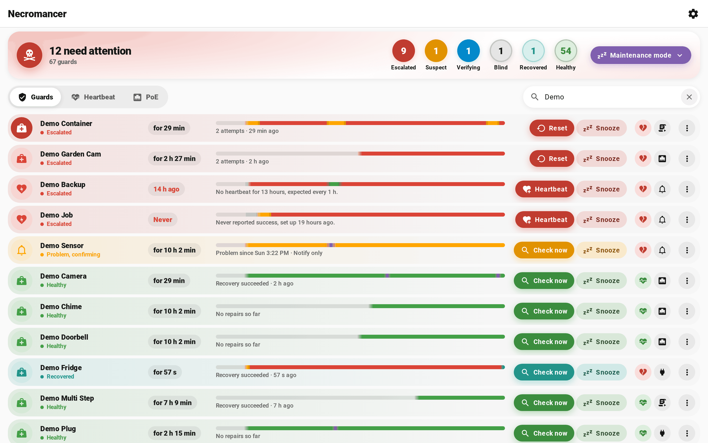
  </picture>
</p>

**Contents:** [Use cases](#use-cases) · [The guard card](#the-guard-card) ·
[Buttons](#buttons) · [Recovery popup](#recovery-popup) · [The sidebar page](#the-sidebar-page) ·
[YAML reference](#yaml-reference) · [Visual editor](#visual-editor) ·
[Performance](#performance) · [FAQ](#faq)

## Use cases

### Everything at a glance — the sidebar page

Open **Necromancer** in the sidebar. No setup: every guard, problems first, each row with its
last 24 hours as a coloured strip. Tap a count to see only those guards, tap a row to open the
full card in place. The gear (top right) holds your own settings — see
[The sidebar page](#the-sidebar-page).

### One guard on a dashboard

```yaml
type: custom:necromancer-guard-card
entity: sensor.office_ap_status
```

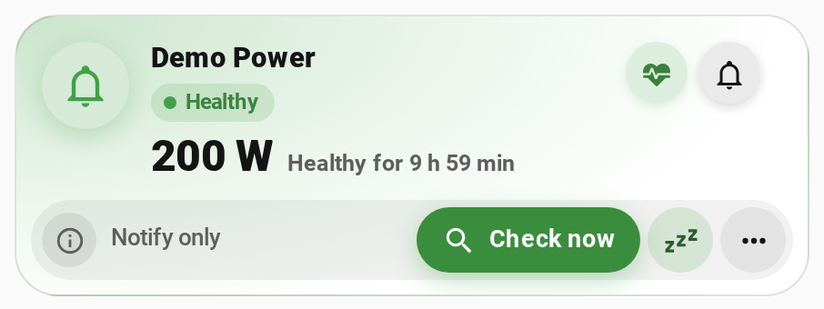

The card shows the guard's state in colour, its main value (here the latency from a sensor you
pick with `value_entity`), the status chips, the last event and the buttons that fit the state.

### A row per guard

```yaml
type: custom:necromancer-guard-card
entity: sensor.pool_pump_status
layout: compact
```

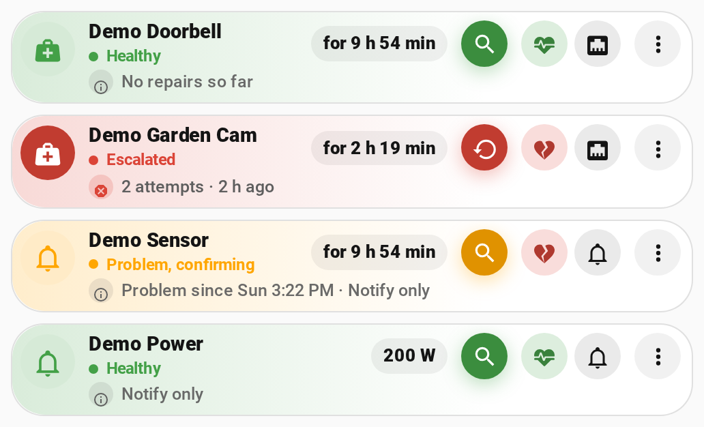

### Just the problems — for the home dashboard

```yaml
type: custom:necromancer-guards-card
title: Needs a look
filter:
  states: [escalated, suspect, blind]
```

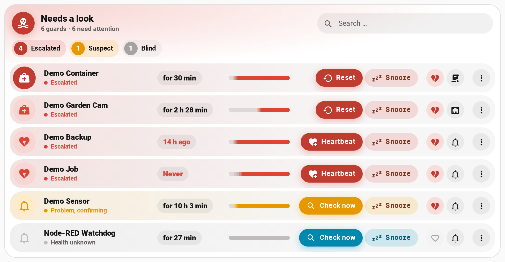

When nothing is wrong, the card says so in one line. Without a `filter` it lists every guard and
offers the bulk actions (*Maintenance mode*, *Wake all*).

### A full card per guard

```yaml
type: custom:necromancer-guards-card
title: Cameras & network
display: cards
filter:
  label: network
```

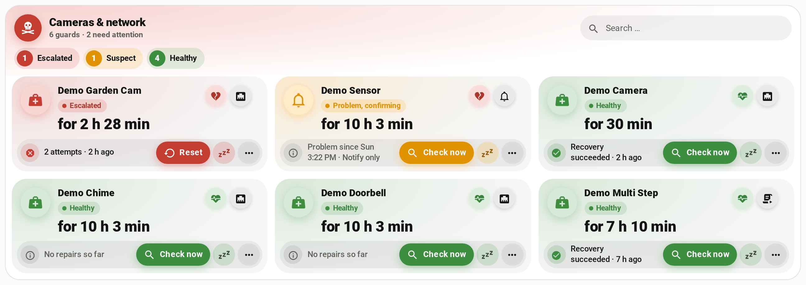

### The last 24 hours

```yaml
type: custom:necromancer-guard-card
entity: sensor.nas_status
timeline: true
```

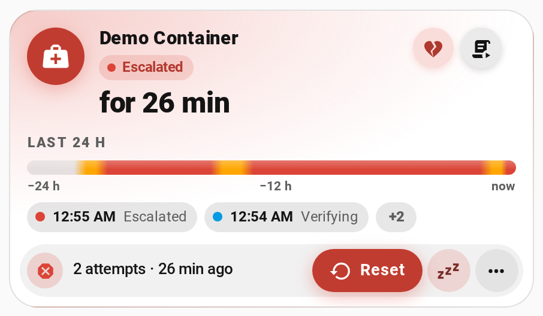

### A wall tablet that cannot trigger anything

```yaml
type: custom:necromancer-guards-card
show_actions: false
```

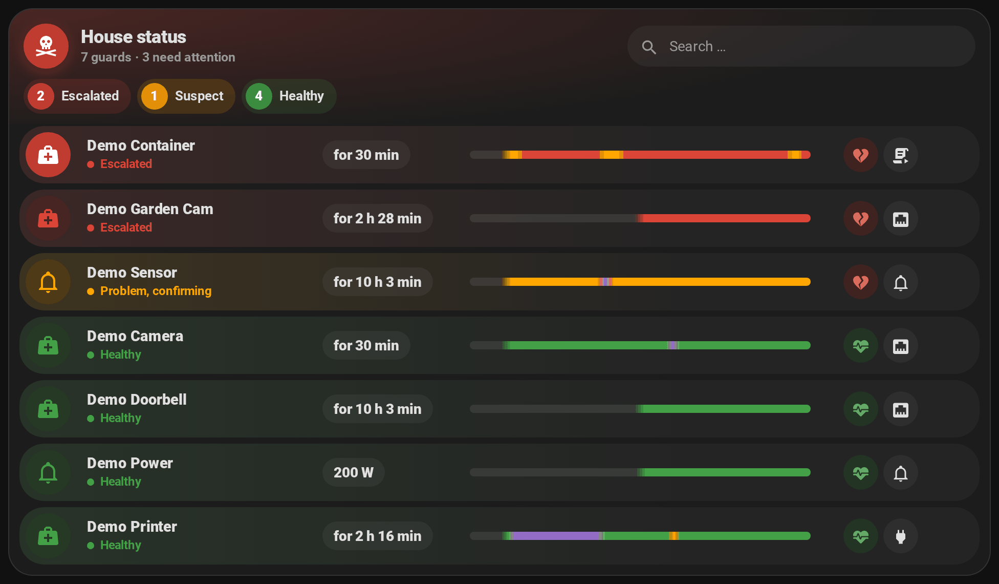

`show_actions: false` removes every button, the menu and the bulk actions; the chips and the
recovery popup then only inform.

### PoE ports

```yaml
type: custom:necromancer-poe-card
```

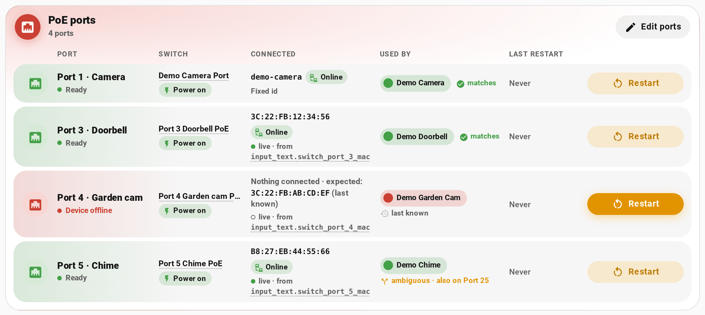

One row per PoE port from Necromancer's port list: switch, power and link state, the connected
device (live or fixed id), the guards using the port, the last restart and *Restart port*. For
admin users only — the port list names every switch and device id.

## The guard card

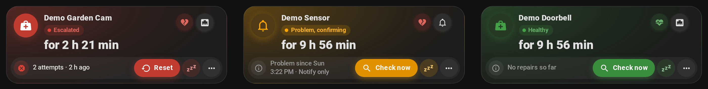

| Part | What it shows |
|---|---|
| Icon bubble | The guard type (or your `icon`), in the state colour; tap = details |
| State badge | *Healthy*, *Problem, confirming*, *Repairing*, *Escalated*, *Snoozed until …* |
| Main value | A heartbeat guard: the last ping ("2 min ago", red when overdue). A numeric state guard: its value ("200 W"). With `value_entity`: that entity's state and unit. Otherwise how long the guard has been in its state ("for 3 d", kept across a restart) |
| Chips | Health, the recovery chip, *Auto off*, then your own `chips` after a thin rule |
| Last event | "Recovery succeeded · 2 h ago", "2 attempts · 1 h ago" — or a quiet line like "No repairs so far" |
| Buttons | The state's main button and *Snooze*, the rest in the ⋮ menu — see [Buttons](#buttons) |

**Chips**, always in this order:

- **Health** — green, red or grey; tap = the health entity.
- **Recovery** — what Necromancer repairs, with the target's own icon (else a plug, a PoE port, a
  script, or a bell for a notify-only guard); blue while it repairs. Tap = the
  [recovery popup](#recovery-popup).
- **Auto off** — orange while auto-recovery is off: problems are only reported. Tap twice to turn
  it on again.
- **Your chips** (`chips:`) — any entity, green when `on` (red for a problem-type binary sensor),
  grey otherwise, or the colour you set. Tap = the entity's details. A chip on the recovery target
  is not repeated.

## Buttons

Two pills, always in the same places. On the left the state's main move:

| State | Main button |
|---|---|
| escalated | *Heartbeat* for a heartbeat guard (the job, not the guard, needs a sign of life), else *Reset* |
| problem, confirming / blind | *Revive* for a guard that repairs, *Heartbeat* for a heartbeat guard, else *Check now* |
| repairing / verifying | none (something is already happening) |
| snoozed | *Wake up* |
| healthy | *Heartbeat* for a heartbeat guard, else *Check now* |

On the right ***Snooze*** (30 min, 1 hour, 4 hours, 1 day) while it applies. Everything else is in
the **⋮ menu**, in this order: *Revive* (on a snoozed guard it also ends the snooze), *Reset*,
*Heartbeat*, *Check now*, then after a rule *Copy heartbeat URL* and *Edit* (admins only) and
*Details*.

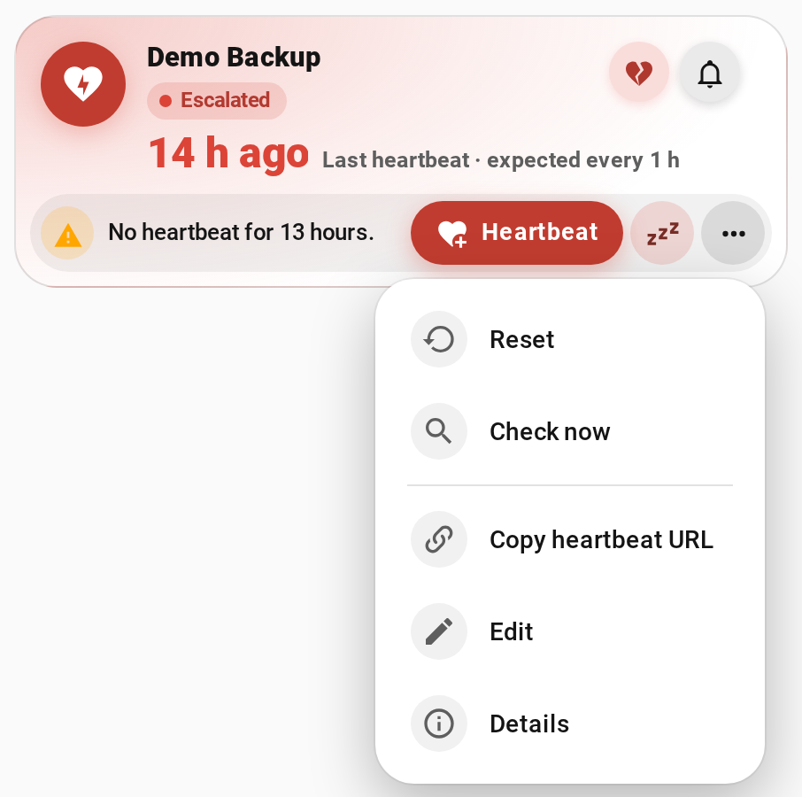

- *Revive* and *Heartbeat* ask **Sure?** first (tap again within 3 s).
- *Copy heartbeat URL* copies the secret URL to the clipboard — it is never shown on screen.
- A narrow row shows only the main button, as an icon; its menu then has *Snooze* too.
- Auto-recovery is switched in the recovery popup (or with a double tap on *Auto off*), not
  from a button.

## Recovery popup

Tap the recovery chip:

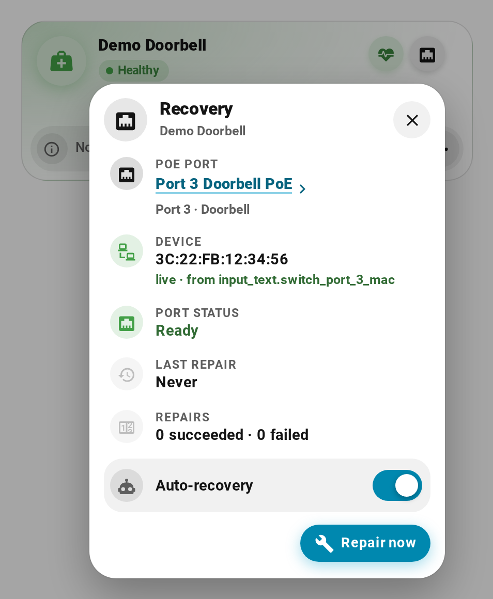

- **What is repaired:** the switch, the one script, the off/on actions, or — for a PoE guard —
  the port where the device's id is found right now (live, last known, or *ambiguous* when it
  shows up on several ports), with the port's status.
- **Last repair** and the counters (succeeded / failed).
- **Auto-recovery** switch — turning it off asks *Sure?*.
- **Repair now** — runs the guard's Revive after *Sure?*; disabled with the reason while it
  cannot run (busy, snoozed, the port is ambiguous, …).

Nothing in the popup switches power directly; a link opens Home Assistant's own details. On a
phone the popup is a bottom sheet.

## The sidebar page

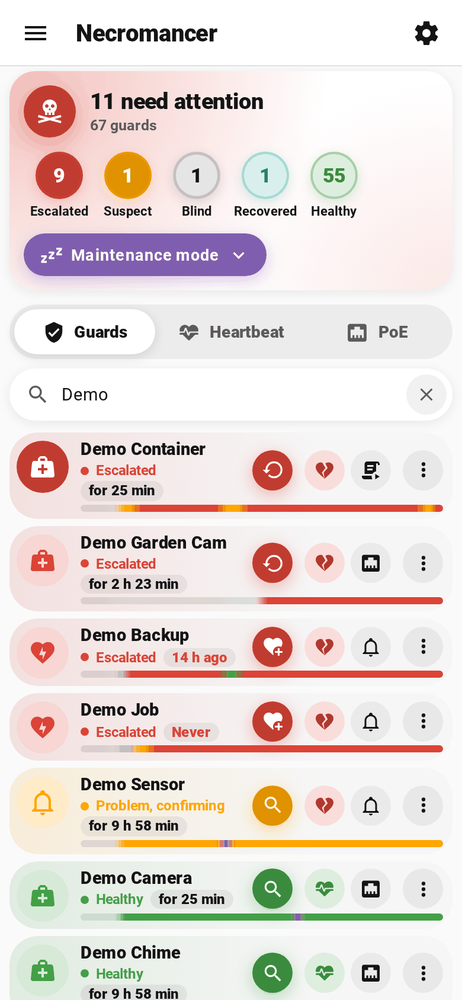

Counts per state (tap = only those), tabs *Guards*, *Heartbeat* and *PoE* (when ports exist), a
search field and the maintenance mode (snooze all guards for a while, wake all). The gear holds
settings per user, stored in your profile on every device:

| Setting | Default | |
|---|---|---|
| Show counters | off | "4 repaired · 1 failed" under the last event |
| Show actions | on | off: no buttons anywhere on the page |
| Show the last event | on | |
| Collapse quiet guards | off | healthy guards in one folded group |
| Guard list | List | *List* or *Cards* (a full card per guard) |
| Show 24 h timeline | off | with *Cards*: the 24 h section on every card |
| Row shows | Timeline | *Timeline* (24 h strip) or *Text* (the last event) |
| Sort | Problems first | *Problems first, then name*, *Name*, *State*, *Last activity* |
| Start tab | Guards | |

Admins turn the page off for everyone with the option **Show in the sidebar** (*Configure* on the
Necromancer entry); anyone can hide it for themselves in their profile.

## YAML reference

All options except `entity` are optional. Pick the cards in the card picker (*Necromancer Guard*,
*Necromancer Guards*, *Necromancer PoE ports*) or write them in the code editor.

### Guard card — `custom:necromancer-guard-card`

| Option | Type | Default | Description |
|---|---|---|---|
| `entity` | entity id | **required** | The guard's status sensor (`sensor.<guard>_status`) |
| `name` | string | the guard's name | Title of the card |
| `icon` | icon | by guard type | Icon in the bubble |
| `layout` | `full` \| `compact` | `full` | One card, or one row |
| `value_entity` | entity id | see [main value](#the-guard-card) | Entity shown as the main value |
| `value_name` | string | the entity's name | Caption next to `value_entity` |
| `chips` | list | none | Extra chips: entity ids, or objects with `entity`, `name`, `icon`, `color` |
| `timeline` | boolean | `false` | Full card: the 24 h section (strip, time axis, latest changes) |
| `row_detail` | `text` \| `timeline` | `text` | Compact card: the last event or the 24 h strip under the name |
| `show_counters` | boolean | `false` | Repair counts under the last event |
| `show_footer` | boolean | `true` | The last event |
| `show_actions` | boolean | `true` | `false`: no buttons, no menu; chips and popup only inform |

`color` of a chip: a tone (`good`, `bad`, `warn`, `active`, `idle`, `snooze`), a Home Assistant
colour name (`red`, `light-blue`, …) or a hex colour (`#ff9800`).

```yaml
type: custom:necromancer-guard-card
entity: sensor.office_ap_status
name: Office AP
icon: mdi:access-point
value_entity: sensor.office_ap_latency
value_name: Latency
chips:
  - binary_sensor.internet
  - entity: binary_sensor.ups_problem
    name: UPS
    icon: mdi:battery-alert
    color: red
show_counters: true
```

### Guards card — `custom:necromancer-guards-card`

| Option | Type | Default | Description |
|---|---|---|---|
| `title` | string | `Necromancer` | Header title |
| `filter` | mapping | none | Which guards — see [filter](#filter) |
| `entities` | list | all guards | A fixed list of status sensors instead of all guards |
| `sort` | `problems` \| `name` \| `state` \| `last_activity` | `problems` | Problems first (newest escalation on top), then by name |
| `display` | `list` \| `cards` | `list` | One row per guard, or a full card per guard |
| `row_detail` | `timeline` \| `text` | `timeline` | What a row shows under the name |
| `timeline` | boolean | `false` | With `display: cards`: the 24 h section on every card |
| `collapse_ok` | boolean | `false` | Fold the quiet (healthy) guards into one group |
| `value_entities` | mapping | none | Main value per guard: `sensor.<guard>_status: sensor.<value>` |
| `show_counters` | boolean | `false` | Repair counts on every guard |
| `show_footer` | boolean | `true` | The last event on every guard |
| `show_actions` | boolean | `true` | `false`: no buttons, no menus, no bulk actions |
| `bulk` | boolean | `true` | *Maintenance mode* and *Wake all* in the header (only without `filter` and `entities`) |
| `show_header` | boolean | `true` | The header with title, counts, search and bulk actions |

#### Filter

All keys are optional and combine with AND; each takes one value or a list.

| Key | Values |
|---|---|
| `states` | `ok`, `suspect`, `blind`, `recovering`, `verify`, `cooldown`, `escalated`, `snoozed`, `unavailable` |
| `types` | `recovery` (a guard that repairs), `heartbeat`, `notify` (notify only) |
| `area` | area id or name — the guard's own or its device's |
| `label` | label id or name — on the guard's status sensor or its device |

```yaml
type: custom:necromancer-guards-card
title: Network
filter:
  label: network
  types: [recovery]
value_entities:
  sensor.office_ap_status: sensor.office_ap_latency
```

```yaml
type: custom:necromancer-guards-card
title: Jobs
filter:
  types: heartbeat
row_detail: text
sort: last_activity
```

### PoE card — `custom:necromancer-poe-card`

| Option | Type | Default | Description |
|---|---|---|---|
| `title` | string | `PoE ports` | Header title |
| `ports` | list | all ports | Port names to show; `Port 5` also matches `Port 5 · Chime` and a port named just `5` |

```yaml
type: custom:necromancer-poe-card
title: Basement switch
ports: [Port 1, Port 2, Port 5]
```

### In a sections view

The cards size themselves: a guard card takes the full width of a section (at least half of
it), the guards and PoE cards take the full width of the view. Change it under *Layout* in the
card editor, or with `grid_options` as for any card.

## Visual editor

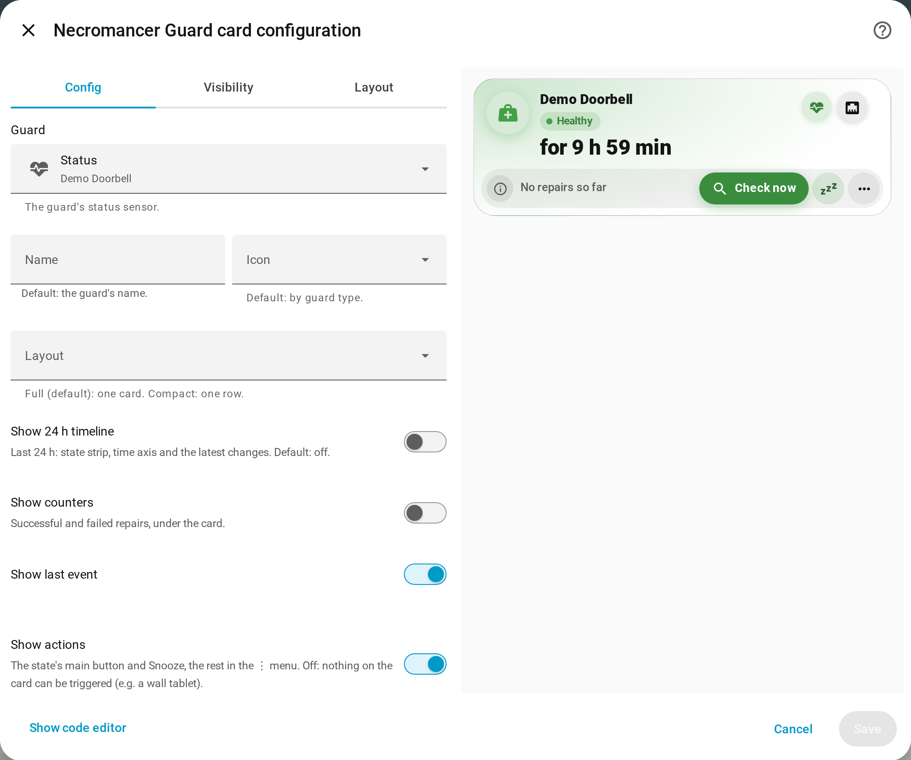

Every card has Home Assistant's own visual editor. Each field says its default; the options that
only matter for one layout appear only there (*Show 24 h timeline* for a full card, *Row shows*
for a compact one). Filters, a fixed list of guards and the values per guard are YAML only — use
*Show code editor*.

## Performance

- The cards update only when one of their own guard's entities changes; a list draws only what
  is on screen and creates no cards for a folded group.
- The 24 h strip loads the history of **all** visible guards in one request, then follows the
  states Home Assistant sends anyway — no subscription per guard. On a test system with 67 guards
  that request took about 40 ms. `row_detail: text` (and a full card without `timeline: true`)
  makes no history request at all.
- A status sensor excluded from the recorder shows only the changes since the page was opened.

## FAQ

**A dashboard still shows the old card after an update.** Reload the page (the module carries the
integration version; browsers occasionally keep the old one until a reload). In the companion
app, reset the frontend cache in the app's settings.

**"Custom element doesn't exist: necromancer-guard-card".** The Necromancer integration is not
loaded (no entry, or the entry failed to set up) — the cards come with it.

**Do non-admin users see everything?** They see the guards and can use the buttons. *Copy
heartbeat URL*, *Edit* and the PoE card are for admins only; the recovery popup hides entities
the user may not read.

**I used the dashboard from `docs/dashboard` before.** It needed six other custom cards and is
gone; replace it with a guards card (or just use the sidebar page). The entities and services
are unchanged, so your own cards and automations keep working.

**Can I still build my own?** Yes — every guard is a set of plain entities (status sensor,
health binary sensor, revive button, auto-recovery switch, recovery event); see
[What you get per guarded device](../README.md#what-you-get-per-guarded-device).
